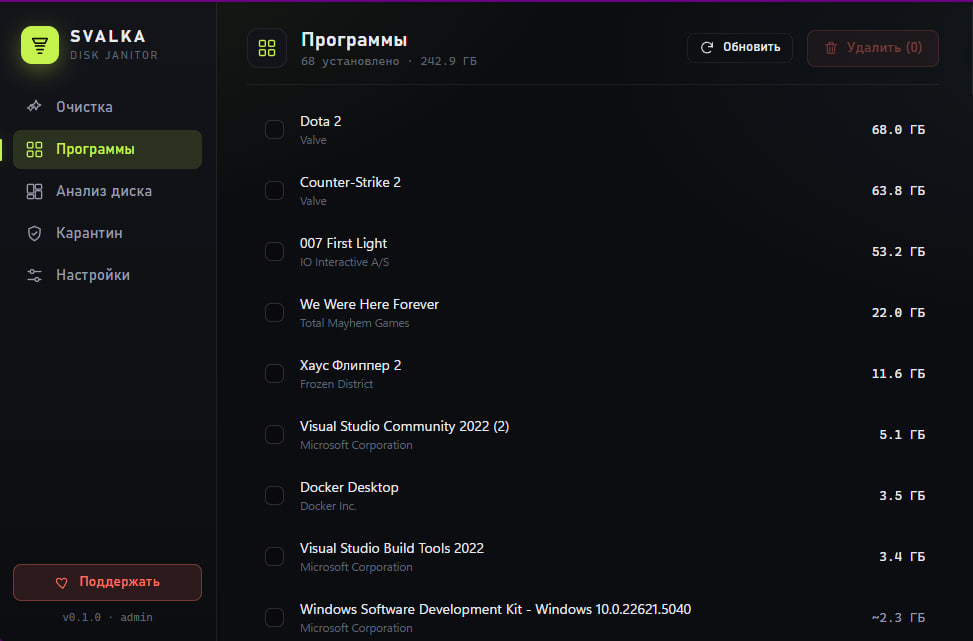
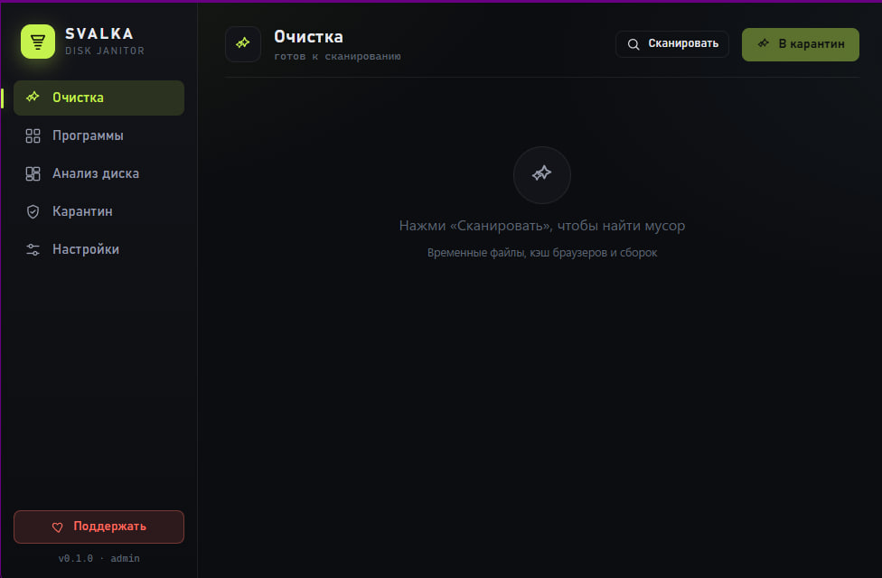

<!-- SUPPORT-START -->
<p align="center">
  <b>💛 Поддержать проект</b> · <b>USDT</b> (Tether) в сети <b>TRC20</b>:<br/>
  <code>TEHHyPSeZ7t5vfVJmjtEBkqJdpfcrm1wqg</code>
</p>
<!-- SUPPORT-END -->

<!-- ROSEVPN-BANNER-START -->
<p align="center">
  <a href="https://t.me/rosevpnru_bot">
    
  </a>
</p>
<p align="center">
  <sub><b>Быстрый VPN с обходом YouTube, Discord, Instagram</b> · Бесплатный пробный период · Подключение за 30 секунд через бот <a href="https://t.me/rosevpnru_bot">@rosevpnru_bot</a></sub>
</p>

---

<!-- ROSEVPN-BANNER-END -->

# Svalka — безопасный чистильщик Windows

<p align="center">
  <strong>Чистит реальный мусор, удаляет программы и освобождает диск — но ничего не удаляет безвозвратно.</strong><br>
  Всё перемещается в обратимый карантин, откуда восстанавливается одной кнопкой.
</p>

<p align="center">
  <a href="https://github.com/by-sonic/svalka/releases/latest"></a>
  <a href="https://github.com/by-sonic/svalka/releases/latest"></a>
  <a href="https://github.com/by-sonic/svalka/blob/main/LICENSE"></a>
  
  
</p>

---

## Скачать

| Платформа | Файл | Описание |
|-----------|------|----------|
| **Windows** 10 / 11 (x64) | [Svalka-setup.exe](https://github.com/by-sonic/svalka/releases/latest) | Установщик (NSIS) |

> Перейдите в [Releases](https://github.com/by-sonic/svalka/releases/latest) и скачайте последнюю версию. Запускайте **от имени администратора** — без этого нельзя чистить системные папки.

---

## Что это?

**Svalka** (Сва́лка — «свалка», «мусорка») — десктопное приложение для Windows, которое наводит порядок на диске, **не рискуя вашими данными**. Оно сканирует настоящий мусор (системный кэш, кэш браузеров, кэши разработчика), удаляет программы пачками, показывая их **реальный** размер на диске, ищет «хвосты» от деинсталляторов — и делает **каждое удаление обратимым**, перемещая файлы в карантин вместо безвозвратного стирания.

> Нашёл лишнее → положил на свалку → передумал → достал обратно. Ничего не уничтожается.

### Ключевые возможности

- **Ничего не удаляется — всё в карантин.** Любой «удалённый» файл можно восстановить в точное исходное место.
- **Реальные размеры.** Программы и папки показываются с фактическим размером на диске (параллельный обход через `jwalk`), а не с тем, что заявил установщик.
- **Пакетное удаление программ** с поиском оставшегося мусора (leftovers).
- **Анализ диска.** Treemap использования диска + список самых крупных файлов — видно, что именно «съело» место.
- **Жёсткий дени-лист.** Защищённые расположения (`System32`, `WinSxS`, `Cookies`, `Login Data`, `hiberfil.sys` …) не тронет, даже если сканер их вернул.
- **Без телеметрии.** Open-source, ничего не отправляет наружу. Весь код открыт для аудита.

---

## Почему это безопасно

Это главная идея проекта. Обычные чистильщики удаляют файлы безвозвратно — и если они ошиблись, восстанавливать нечего. Svalka устроена иначе:

- **Не удаление, а перемещение.** Мусор атомарно и мгновенно переносится (`rename` в пределах тома) в `<том>\.svalka-quarantine\<id>\`, фиксируется в JSON-манифесте и может быть восстановлен по исходному пути. У каждого файла свой индексированный подкаталог, поэтому два элемента с одинаковым именем (например, `Cache` Chrome и Edge) никогда не конфликтуют.
- **Жёсткий дени-лист.** Даже если сканер вернул защищённый путь — он отбрасывается. Пути сначала канонизируются, поэтому короткие имена 8.3 и junction-и не проскользнут мимо проверки.
- **Устойчивые пачки, без «осиротевших» файлов.** Элементы переносятся независимо: заблокированный / занятый файл (открытый браузер, держащий свой кэш — обычное дело) пропускается и попадает в отчёт, но не валит всю очистку. Манифест пишется атомарно: если записать пачку не удалось, перемещения откатываются — ничего не остаётся «перемещённым-но-незаписанным» (а значит невосстановимым).
- **Восстановление не затирает.** Если исходный путь уже занят, восстановление прерывается, а не перезаписывает существующее.
- **Автоочистка.** Записи карантина старше 30 дней удаляются при запуске.
- **Безопасность реестра.** Ключи реестра экспортируются в `.reg` (через полный путь к `reg.exe`) до любого изменения и импортируются обратно при восстановлении.
- **Никаких «тихих» ошибок.** Результаты удаления и карантина несут сообщения; сбои показываются в интерфейсе, а не проглатываются.

---

## Экраны

Пять экранов — всё, что нужно для уборки, и ничего лишнего:

| Экран | Назначение |
|-------|------------|
| **Очистка** | Сканирует мусор по категориям (система / браузеры / кэши разработчика) и отправляет в карантин |
| **Программы** | Установленные программы с реальными размерами, пакетная деинсталляция + поиск хвостов |
| **Анализ диска** | Treemap использования диска и список самых крупных файлов |
| **Карантин** | Просмотр и восстановление перемещённого, ручная очистка |
| **Настройки** | Параметры приложения |

<!-- SCREENSHOTS-START -->
<p align="center">
  <br>
  <sub><em>Программы — реальный размер на диске и пакетное удаление</em></sub>
</p>

<p align="center">
  
  &nbsp;
  
</p>
<p align="center">
  <sub><em>Очистка — поиск мусора по категориям &nbsp;·&nbsp; Настройки — обратимость и автоочистка карантина</em></sub>
</p>
<!-- SCREENSHOTS-END -->

---

## Как это работает

```
Svalka/
  crates/
    svalka-core/   # вся логика, headless, полностью покрыта unit-тестами (без зависимостей от Tauri)
    svalka-app/    # тонкая обёртка Tauri 2: IPC-команды и состояние поверх ядра
  ui/              # фронтенд на Svelte 5 + Vite (пять экранов)
```

- **`svalka-core`** — обычная Rust-библиотека без GUI-зависимостей, поэтому собирается и тестируется на любой машине. Модули: `model`, `fsafe` (атомарное перемещение + проверка одного тома + детект занятых файлов), `sizer` (параллельный подсчёт размеров через `jwalk`), `usage` (ограниченное дерево использования диска + крупнейшие файлы), `quarantine` (перемещение / восстановление / автоочистка + манифест), `regbackup` (экспорт/импорт через `reg.exe`), `scanner` (категории + дени-лист), `programs` (установленные программы из веток реестра с реальными размерами папок), `uninstaller`, `leftovers`, `paths` (известные корни, инжектируемые через окружение).
- **`svalka-app`** связывает IPC-команды/события Tauri с ядром и запрашивает права администратора при старте (нужны для чистки системных папок).
- **`ui`** рисует пять экранов на Svelte 5.

---

## Установка

1. Скачайте установщик из [Releases](https://github.com/by-sonic/svalka/releases/latest).
2. Запустите **от имени администратора** (приложение само запросит UAC — права нужны для работы с системными папками и реестром).
3. Откройте экран **Очистка**, просканируйте и отправьте мусор в карантин. Передумали — вкладка **Карантин**, кнопка «Восстановить».

---

## Разработка

Требуется: **Rust** (stable) + cargo, **Node.js** + npm, **Windows** (логика очистки и работа с реестром — Windows-специфичны).

```sh
# зависимости фронтенда
npm --prefix ui install

# запуск в dev (поднимает Vite, открывает окно Tauri; запросит UAC).
# приложение требует прав администратора — запускайте из терминала «от админа»,
# либо используйте dev.cmd (он сам поднимает права).
cd crates/svalka-app
../../ui/node_modules/.bin/tauri dev
```

### Тесты

```sh
cargo test -p svalka-core                                   # ядро: unit + интеграционные тесты
cargo clippy -p svalka-core --all-targets -- -D warnings    # линт без предупреждений
npm --prefix ui run test                                    # фронтенд (vitest)
```

### Сборка установщика

```sh
cd crates/svalka-app
../../ui/node_modules/.bin/tauri build   # NSIS-установщик в target/release/bundle
```

> Релизные сборки выпускаются автоматически: пуш тега `v*` запускает GitHub Actions ([release.yml](.github/workflows/release.yml)), который собирает NSIS-установщик и прикладывает его к Release.

---

## Стек

| Что | Зачем |
|-----|-------|
| **Rust** | Всё ядро — безопасность памяти и скорость для файловых операций |
| **Tauri 2** | Лёгкая нативная обёртка вместо тяжёлого Electron |
| **Svelte 5 + Vite** | Быстрый и компактный фронтенд |
| **jwalk** | Параллельный обход файловой системы для подсчёта реальных размеров |
| **GitHub Actions** | CI/CD — автоматическая сборка установщика при релизе |

---

## Известные ограничения v1

- **Настройки → дни автоочистки** показываются, но пока не сохраняются; очистка при запуске зашита на 30 дней (небольшая доработка: `get_settings`/`set_settings` поверх `settings.json`).
- **Корзина** смоделирована, но очищается через Windows Shell API в следующей итерации, а не сканированием путей.
- **Карантин ключей реестра** реализован сквозняком (`RegBackup`, экспорт/импорт при восстановлении), но пока ни один экран не отправляет в карантин ключ реестра — файловые хвосты покрыты, карантин реестра переиспользует ту же механику.
- Иконки — временные.

---

## Лицензия

[MIT](LICENSE) — свободное использование, модификация и распространение.

---

<p align="center">
  <strong>by sonic</strong><br>
  <sub>Если проект помог — поставь ⭐️</sub>
</p>

---

### Ключевые слова / Keywords

> чистильщик windows, очистка диска windows, удаление мусора windows, безопасный чистильщик, обратимая очистка, аналог ccleaner, ccleaner альтернатива open source, очистка кэша браузера, удаление программ windows, деинсталлятор с хвостами, анализ диска treemap, какие файлы занимают место на диске, освободить место на диске, очистка системного диска c, windows cleaner, disk cleanup, safe reversible cleaner, open source ccleaner alternative, disk usage analyzer, junk cleaner, uninstaller leftovers, rust tauri desktop app
